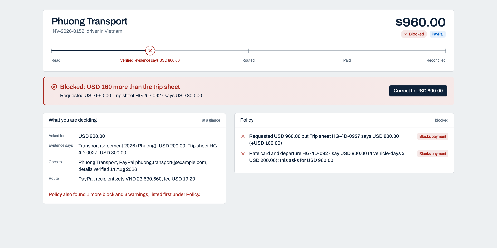
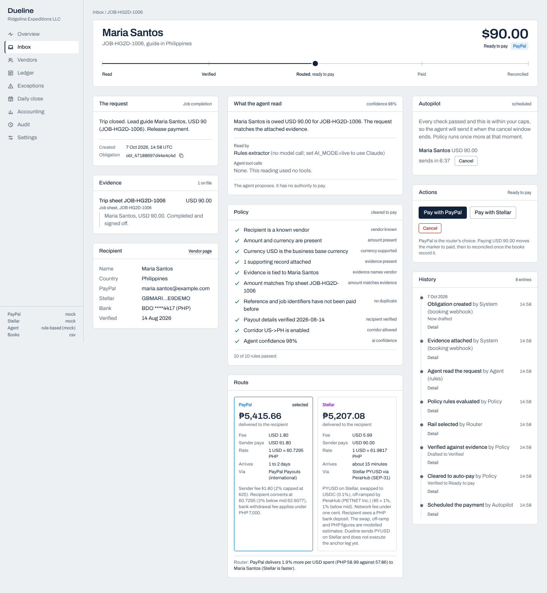
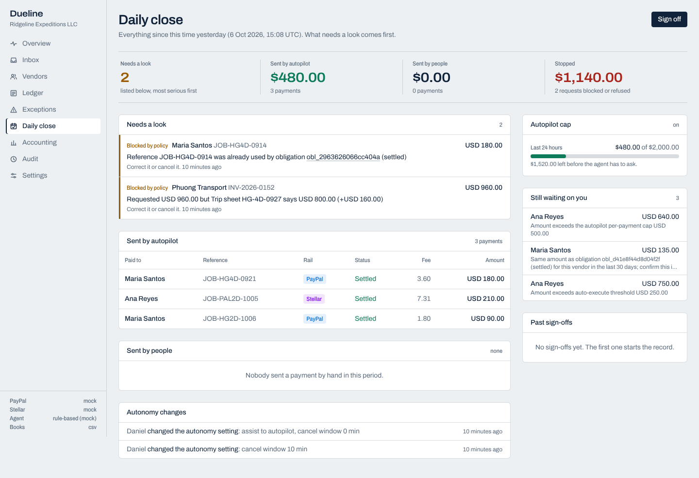

# Checkrail Pay

**Checks every supplier payment before money moves.**

- Blocks inflated and duplicate invoices against the evidence, and against PayPal's own record of what was already paid.
- Pays the clean ones over PayPal, and the agent pays only inside your caps.
- Lands every payment in the books, with a two-minute Daily close.
- Answers any AI agent that asks before it pays a supplier: pay, hold or block, over MCP.

**Try it.** Hosted demo and video: linked from the Devpost page. Login in the Devpost testing instructions.
<!-- Founder: when they exist, replace the line above with:
**Try it:** <hosted URL>/demo (login in the Devpost testing instructions). **Video:** <YouTube URL>

-->

For small service businesses that pay dozens of freelance suppliers from chat messages, Checkrail Pay checks every request against the job it is for, pays the clean ones over PayPal inside limits you set, and stops the rest with a one-line reason. US bill-pay tools assume a purchase order. Checkrail works from job sheets, bookings and rate cards, and it never holds your money.

Built for the PayPal AI Hackathon (project started 3 Oct 2026). The name: a check rail is the short rail laid beside the main track that keeps wheels from leaving it.

## Try it

Run it locally in two commands (Node 22 or later; SQLite is bundled, no external database):

    npm run setup
    npm run dev

Then open http://localhost:3000/demo, the presenter page that walks the story in ten steps, including Autopilot scheduling and sending a payment on its own (step 6 and 7). In development no login is needed. The local copy runs on simulated rails with the rule-based reader and needs no keys.

Hosted demo and video: linked from the Devpost page, with the hosted login in the Devpost testing instructions.

## How it works

Every request travels one line through five stations:

    read ──── verified ──── routed ──── paid ──── reconciled

1. **Read.** An agent reads the request and its evidence (a pasted message, a PDF read from its text layer, a photo read by Claude when a key is set). Claude in live mode, a rule-based reader otherwise. It returns a structured reading, a confidence score and concerns. It cannot pay anyone.
2. **Verified.** A deterministic policy engine, a pure function with no network and no model, runs a set of named rules: known and unblocked vendor, amount and currency, evidence attached and who supplied it, evidence that names the payee in full, amount against the evidence or what is still open on the bill, rate card and departure, duplicate job, the same reference on another payee, verified payout details, corridor, tax form, and the agent's confidence and concerns. Every rule that applies is listed on the payment page. Outcome: block, hold, require approval or pay.
3. **Routed.** Every rail is quoted. Vendor preference first, then the rail that delivers more per dollar the sender actually spends. A gap under 0.5% is a tie, and ties go PayPal, then Wise, then the bank file, then Stellar.
4. **Paid.** Policy runs again, then the rail is called with an idempotency key on the attempt.
5. **Reconciled.** Settlement is confirmed by polling the rail. Bills go to a Xero import file at approval, settlements export as CSV, and the PayPal statement is matched back line by line.

## For agents

PayPal moves money for people. Next it moves money for agents, and agents need a check rail.

Checkrail is an MCP server (`/api/mcp` over HTTP, or `npm run -s mcp` on stdio). Before an agent pays a supplier through any tool, it calls `check_payment` and gets **pay**, **hold** or **block**, the rule that decided, what would clear it, and PayPal's transaction id when PayPal already paid that job. The check runs on an in-memory copy of the books: nothing is paid or saved. An agent with the request scope can hand Checkrail the payment with `request_payment`; it lands in the inbox, where policy and the owner's autonomy setting decide, and Autopilot sends it only inside the caps after the cancel window. No agent can approve or send, see payout details, or shop for a pass by trying amount after amount. Keys, trust levels and examples: [docs/AGENTS.md](docs/AGENTS.md). The Agents page shows every agent and every question.

## What is live and what is simulated

As of 29 Oct 2026:

- **PayPal Payouts sandbox: proven.** Batch RGS5PUZPH4CNY, USD 180 to Maria Santos, settled 12 Oct 2026. Batch W55KNGQK57JC4, USD 750 to Ana Reyes, came back UNCLAIMED and was held, not paid twice.
- **Claude (`claude-sonnet-5-5`): has read the full demo live.**
- **Claude's PayPal tools:** three read-only REST calls to Transaction Search and Invoicing (`paypal_list_transactions`, `paypal_list_invoices`, `paypal_get_invoice`). We call PayPal's REST endpoints directly rather than through the Agent Toolkit so the agent can reach only these three GET calls.
- **PayPal's own records decide a block.** Before every decision that can move money, the app itself (deterministic code, not the model) reads PayPal Transaction Search and blocks with the PayPal transaction id when PayPal already paid this job to this payee (policy rule `paypal_history`, `src/lib/domain/paypalHistory.ts`). On simulated rails it reads what the simulated PayPal rail actually paid. Live it needs Transaction search enabled on the PayPal app. Transaction Search can lag by up to three hours, so Checkrail's own payment history stays the first duplicate check.
- **Recorded Claude readings for the hosted demo.** Claude's readings of the six opening requests, recorded from a live run on 28 Oct 2026 (`claude-sonnet-5-5`, PayPal sandbox), are kept in `src/lib/demo/recordedReadings.ts` for the request page to show, labelled as recorded. Display only: on the hosted demo the decision still comes from the rule-based reader and the policy rules.
- **Read from PayPal (Books):** reconciles from Transaction Search and ties a returned payout to its payout by reference id. Tested against fakes; needs live PayPal keys.
- **Stellar PYUSD: simulated.** The adapter is written to the Stellar SDK and has never run on testnet.
- **Soroban spend-policy contract:** written in Rust on soroban-sdk 29.0.1, 20 unit tests pass. Not deployed to testnet, not called by the app yet.
- **Wise:** beta adapter, never run.
- **Xero:** an import file, not a live push.
- **Hosted demo:** simulated rails and the rule-based reader, with the recorded Claude readings beside it once the request page shows them.
- **Agent guard (MCP):** `check_payment`, `request_payment`, `payment_status`, `lookup_payee`, `explain_rule`, over HTTP and stdio; tested against the demo data, never yet driven by a third-party agent on camera.
- **Tests:** 943 in 91 files (one skipped). **Policy:** named rules in `src/lib/domain/policy.ts`, each listed on the payment page.

The sidebar footer always shows which mode each rail and the reader are in.

## The demo story

Ridgeline Expeditions LLC, a US tour operator paying guides, drivers and homestays in Vietnam and the Philippines, has four open requests.

| Request | Outcome | Why |
|---|---|---|
| Phuong Transport, INV-2026-0152, USD 960 | Blocked | The trip sheet says 4 vehicle-days at USD 200 = USD 800. Correct it to USD 800 and it re-enters the flow. |
| Maria Santos, JOB-HG4D-0914, USD 180 | Blocked | That job was settled 17 days earlier, and PayPal's own record of that payout blocks it too, citing the PayPal transaction id. Shared trip and job identifiers in the text and evidence also catch a re-invoice under a new number. |
| Maria Santos, JOB-HG4D-0921, USD 180 | Paid over PayPal | Under the USD 250 threshold and backed by a trip sheet. The rails are within 0.1% at this size, so the tie goes to PayPal. |
| Ana Reyes, JOB-PAL3D-0927, USD 750 | Approved by a person, then sent | Above the threshold. On simulated rails it settles on Stellar, her preference. In the live sandbox run it went by PayPal and came back UNCLAIMED, and was held. |

Result on simulated rails: 2 settled, 2 errors prevented (USD 340: the USD 160 overpayment plus the USD 180 duplicate). `npm run demo:replay` runs the same story in the terminal. Demo documents to upload (a clean trip sheet, a re-issued duplicate, an unusual rate) are in `docs/demo-documents/`.

## Autonomy

| Level | Checks | Approves | Sends |
|---|---|---|---|
| Review everything | Agent | You | You |
| Assist (default) | Agent | Agent, for clean requests up to USD 250 | You |
| Autopilot | Agent | Agent | Agent, within your caps, after a cancel window |

- Autonomy removes the approval step and nothing else. A mismatched amount, an already-paid job, changed payout details, missing evidence, a disabled corridor, the two-person rule above USD 5,000 and the per-vendor daily cap stop a payment at every level (`src/lib/engine/autopilot.test.ts`).
- Autopilot limits: USD 500 per payment, USD 2,000 per rolling 24 hours across the business, a 10-minute cancel window and a pause that applies at once (defaults; the owner changes them).
- Autopilot never sends a first payment to a vendor, an amount at least 3 times the vendor's usual, a payment a person approved, or one backed only by the vendor's own documents. What counts as support that is not the vendor's (a job sheet, booking or purchase order from a connected system, or the rate card and departures) can be set or changed only by an approver or the owner, never by the clerk who prepares the payment. A rate card confirms a payment only once the departure it names has ended: nothing is paid without a person on a trip that has not run.
- Policy runs again at release. If anything changed in the cancel window, no rail is called and the refusal shows in the Daily close.
- The Daily close (`/close`) lists what needs a look first, then what autopilot sent, what people sent and spend against the cap. Sign off writes an audit entry of exactly what was on the page.

## Safety

### The model cannot pay
- Its only output is an interpretation: vendor, amount, reference, summary, confidence, concerns.
- Its PayPal tools are read-only REST calls (`src/lib/ai/paypalTools.ts`). There is no tool that moves money.
- Its output is clamped and validated. Its concerns can add a reason to stop, never remove one.
- Autopilot is a timer over policy, not the model deciding to pay.

### Policy decides
- `evaluatePolicy` in `src/lib/domain/policy.ts` is a pure function: same input, same output.
- Only the payee's full name on a record binds the amount to that payee. A partial name or a shared word raises a warning.
- Each approval records the warnings on screen. A new warning sends the payment back for a fresh look.

### The money path
- Every attempt carries an idempotency key: PayPal `sender_batch_id` plus the `PayPal-Request-Id` header; Stellar uses the memo and checks the treasury history before sending.
- A timeout, 5xx or lost response is "unknown", never "failed". The payment stays pending and is replayed under the same key. A new key is issued only after a definitive failure.
- Starting an execution is one SQLite transaction, and state moves are compare-and-swap through a whitelist (`TRANSITIONS` in `src/lib/domain/types.ts`).
- The payout destination is pinned at approval. Edited details send the payment back to blocked.
- Webhooks never set state. A signature-verified event only triggers a re-check.
- Live mode never falls back to a mock. Missing credentials throw.

### People and access
- Named logins with roles (owner, approver, clerk, accountant) and approval limits.
- Whoever prepares a payment does not approve it while someone else can. Dual approval counts distinct people.
- Payout detail changes need a second person with a stated verification method.

### Reviews
- Six review rounds on 16 Oct by AI agents briefed as critics (`docs/CRITIC_REVIEW_02.md`, `docs/critic/`), and three further review rounds from 25 to 27 Oct by AI agents briefed as a security analyst and as an AP practitioner, each working from a clean copy of the repo (`docs/audits/`). No human security audit has been done yet. Round 1 findings were fixed with tests. Round 2 findings are listed in `docs/audits/` with their status; some are still open (see there).

### Known gaps
- No inbound email or Zalo intake yet: requests are pasted or uploaded. No notifications, so the cancel window is a delay, not an alert.
- The webhook signature check is unit-tested, not yet exercised by a real PayPal event.
- No Stellar anchor leg, PYUSD to USDC path payment, fee bumps or SEP-29 memo checks.
- The bank file is a generic CSV to map to each bank's template. Xero is a file import.
- The autopilot heartbeat assumes one server process. SQLite, logins in an environment variable.
- The agent shares a PayPal app that has Payouts scope. Use a separate read-only app before real money.

## The two files for the bookkeeper

- **Xero bills file** (Accounting, "Export new bills"): one bill per invoice, written at approval, in Xero's "Import bills" template. A deposit and its balance are one bill.
- **Settlement CSV** (Accounting, "Export CSV"): one row per settled payment, for matching to the bank feed.

Changed 1 Nov 2026: the bills file is now at the invoice's gross amount, with no "Tax withheld" line. Tax kept back from a vendor is recorded when the payment is matched, as a second payment on the bill from the withholding liability account (825, or `XERO_WITHHOLDING_ACCOUNT`) for the row's `withheldAmount`. A new last column, `xeroPayment`, is `xero:<payment id>` when the live Xero connection has sent all of that payment and `xero:sending` while it will; only rows where it is blank need entering by hand (docs/XERO.md).

They describe the same purchase the same way. The settlement row uses the bill's reference as `reference`, the bill's description ("Accommodation services HS-1027, departure HG-4D-1004", "Cash advance ADV-HG4D-1101"; never the request text) and the bill's account: the vendor's own code, else one by role (310 guides and drivers, 320 homestays and hotels, 400 creators, 429 other), and the prepayment account for a cash advance (620, or `XERO_ADVANCES_ACCOUNT`). The CSV `accountCode` starts with the same code the bills file carries and adds the usual name.

`netPaid` is what left the bank account, on every rail: the amount sent plus the fee for PayPal, Wise and the bank file, which charge their fee on top. Only Stellar takes its fee out of the amount, so its net is the amount, and the `feeAmount` on a Stellar row is borne by the vendor, not paid by the business. The vendor's remittance message and advice say so ("a USD 13.25 fee was deducted from the amount; you receive PHP 45,664.99"). A VND amount is whole dong in both files and on the Accounting page ("10800000", not "10800000.00").

Changed in practitioner round six (PR6-4): `netPaid` was the amount alone for Wise and the bank file, so it did not equal the money that left the account; an advance was classed as 310 in the CSV and 620 in the bills file; `description` was the reader's one-line summary of the request, cut at 120 characters; VND carried `.00`. If you already import the settlement CSV, `netPaid` for Wise and bank-file payments is now larger by the fee, and `description` and `accountCode` for advances differ from earlier rows.

## Re-check your own past payments

Before trusting Checkrail with new payments, run your last few months of supplier payments through the same rules, on your own machine, and see what it would have stopped. Nothing is paid and your real books are never opened: the run uses a throwaway in-memory database, simulated rails and the rule-based reader, whatever `.env` says.

    npm run recheck -- --inspect private/payments.private.csv   # column names and row count, no values
    npm run recheck -- --example-config                         # writes private/recheck.config.json to edit
    npm run recheck                                             # flags, plus private/recheck-results.private.csv
    npm run recheck -- --totals                                 # totals from the lines you confirmed

- Inputs are CSV (from Excel: Save As, CSV UTF-8): a bank statement or payment list, and optionally the job records (dispatch sheet, bookings) that each payment should match. Day-first dates and Vietnamese number formats are read as written.
- Each payment is judged on the date it was made, then recorded as paid, so a later payment for the same job is judged against it, and the 30-day same-amount check uses that day's clock.
- Account numbers, phone numbers and email addresses are removed when the files are read. Everything stays in `private/`, which git ignores.
- What comes out are flags, not findings. Mark each duplicate and overcharge `yes` or `no` in the results file; `--totals` counts only confirmed lines.

### In the app: Getting started

The same re-check runs from the app, as the first step of onboarding (sidebar, Admin, Getting started):

1. **Bring in your data.** Upload a bank export (any bank's CSV, including Vietnamese exports with day-first dates and dot thousands). Checkrail guesses which column is which, shows the first rows as it reads them (account numbers, phones and emails removed) and saves the layout, so the next export from the same bank maps itself. Payout details are never imported. "Re-check 90 days" runs the rules over the last 90 days in a separate process with no keys and simulated rails, so nothing is paid and the server's clock is never touched.
2. **Check our calls.** Every hold and block from the re-check, in an AG Grid table, with "Right catch" and "Was fine" on each. Marks never change a rule; they produce suggestions (add a rate card, verify a supplier, connect a booking feed) that a person applies or dismisses, and every decision goes in the audit log.
3. **Your first weeks.** An AG Studio dashboard: readiness for the next autonomy level as a gauge (holds that turned out fine under 10% for two weeks running, every paid supplier verified, no missed duplicate, rate cards covering 80% of spend, and four weeks in Assist before Autopilot), holds that turned out fine by week against the 10% target, money stopped by reason and how often you agreed with each rule. Both of the first two are custom Studio widgets in the Checkrail theme. The owner can rearrange and add widgets without code, and with live AI on, "Ask about your setup" is a Checkrail agent (Claude Haiku 5.5 through `/api/studio-ai`) that hands work to Studio's own agents. It explains the numbers and adds widgets; it cannot change a rule or pay anyone. Set the licence key as `AG_STUDIO`; without one Studio shows its trial watermark.

## Switching to live mode

Everything runs with zero credentials on simulated rails. To move a rail or the agent to live, copy `.env.example` to `.env`, set the variables below and restart. In live mode a rail with missing or invalid credentials refuses to start instead of falling back to a mock, and the app refuses to open without logins.

**Logins (required in live mode)**

    CHECKRAIL_USERS=owner:<pw>:admin,minh:<pw>:approver,lan:<pw>:clerk,thu:<pw>:accountant
    CHECKRAIL_SESSION_SECRET=<16+ random characters>

People sign in on `/signin`, a plain form that works with JavaScript off and in embedded browsers. It sets a signed, httpOnly session cookie for 12 hours. Scripts and tests can keep sending the same login as HTTP Basic. A page request without either is sent to `/signin`; a fetch or API call gets a 401 in JSON.

**PayPal sandbox.** Create an app at developer.paypal.com, enable Payouts, and tick Transaction search and Invoicing so Claude's checks and Read from PayPal work. For webhooks, set `PAYPAL_WEBHOOK_ID` and point the webhook at `/api/webhooks/paypal`.

    RAIL_MODE=live
    PAYPAL_CLIENT_ID=...
    PAYPAL_CLIENT_SECRET=...
    PAYPAL_ENV=sandbox
    DEMO_PAYPAL_RECIPIENT=<sandbox personal account email>
    DEMO_PAYPAL_RECIPIENT_ROSA=<a second sandbox personal account>
    STELLAR_RAIL=mock          # keep Stellar simulated while testing PayPal alone

**Stellar testnet.** `npx tsx scripts/stellar-setup.ts` creates a treasury and a demo recipient with PYUSD trustlines. Fund the treasury with test PYUSD from the Google Cloud Web3 faucet or the Paxos faucet. Never paste the secret into chat.

    STELLAR_NETWORK=testnet
    STELLAR_TREASURY_SECRET=S...
    STELLAR_PYUSD_ISSUER=GBT2KJDKUZYZTQPCSR57VZT5NJHI4H7FOB5LT5FPRWSR7I5B4FS3UU7G
    DEMO_STELLAR_RECIPIENT=G...

**Claude**

    AI_MODE=live
    ANTHROPIC_API_KEY=sk-ant-...
    ANTHROPIC_MODEL=claude-sonnet-5-5

**Local bank payouts and books**

    WISE_API_TOKEN=...
    WISE_PROFILE_ID=...
    WISE_ENV=sandbox
    BANK_FILE_SOURCE_ACCOUNT=VCB 0071000... Ridgeline Vietnam
    CHECKRAIL_DATA_KEY=<32 bytes, base64>   # encrypts full bank account numbers; required with any live rail (sandbox too) and on any production server that is not the simulated demo. Generate: openssl rand -base64 32

Then run `npm run demo:replay` to send the clean requests through the sandbox. `.env.example` documents every other variable, including the autopilot heartbeat (`AUTOPILOT_HEARTBEAT=off` plus `POST /api/autopilot/tick` for more than one server process; an outside scheduler calls it with `Authorization: Bearer $CHECKRAIL_TICK_TOKEN`, which live rails require).

## Hosting

`render.yaml` is a Render Blueprint for the hosted judging demo: simulated rails, the rule-based reader, logins from `CHECKRAIL_USERS`, and a reset to the four opening requests after 30 minutes without use. It is one shared database, so two judges in the same half hour see each other's changes. Reset demo on `/demo` restores it at any time.

## Tests

    npm test
    npm run typecheck
    npm run lint
    npm run build

943 tests in 91 files (one skipped). `src/lib/engine/story.test.ts` runs the whole demo through the orchestrator and asserts each outcome.

## Project layout

    src/lib/domain/       types, policy (pure), routing, state machine
    src/lib/engine/       orchestrator, autopilot, daily close, users, vendors, runs, bills, rate cards, books, taxes
    src/lib/ai/           Claude agent, read-only PayPal tools, rule-based reader
    src/lib/rails/        PayPal Payouts, Stellar, Wise (beta), bank file, mock adapters, fee model
    src/lib/accounting/   accounting records, CSV export, Xero mapping and bills file
    src/lib/agent/        agent guard: MCP handler, agent keys and trust, check and request tools, rule glossary
    src/lib/check/        judge a payment on a copy of the books; the historical re-check
    src/lib/onboarding/   bank-export import, column detection, calibration marks, suggestions, readiness, dashboard data
    src/lib/studio/       AG Studio theme, data sources, report, custom widget models, Claude adapter for Studio's assistant
    src/app/              Next.js pages and API routes (export, PayPal webhook, autopilot tick, MCP)
    scripts/              seed, replay, re-check, MCP over stdio, Stellar setup, screenshots
    docs/                 agents guide, Devpost text, video script, business notes, benchmark, audits

A Soroban spend-policy contract (caps, payee allow-list, cancel window and pause enforced on chain) lives in `contracts/spend-policy`; see its README.

## Licence

MIT. See `LICENSE`.
