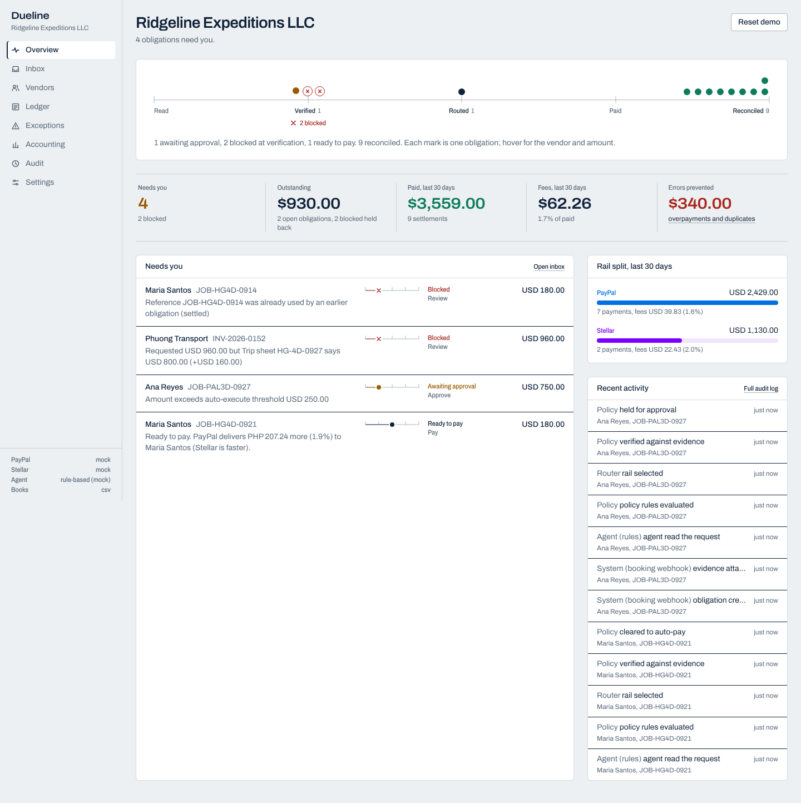
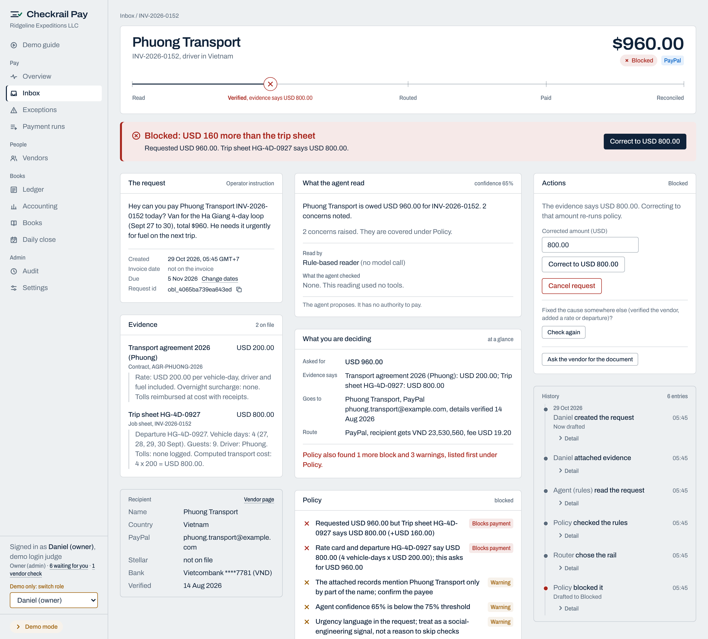

# Checkrail Pay

**Verified supplier payments, routed and reconciled automatically.**

[checkrailpay.com](https://checkrailpay.com) (domain registered; site not live yet). The name: a check rail is the short rail laid beside the main track that keeps wheels from leaving it. Checkrail Pay checks every payment before money moves.

Checkrail Pay is an AI payables operations layer for small businesses that pay a distributed roster of contractors and suppliers, often across borders. It reads payment requests as they arrive (a pasted message, a PDF invoice or job sheet read from its text, a photo read by Claude when a key is set), works out who is owed what, refuses the ones that are wrong, picks the cheaper or faster rail between PayPal Payouts and Stellar PYUSD, pays, and lands every settlement in an accounting-ready export.

Built for the PayPal AI Hackathon (submissions close Nov 12, 2026; project started Oct 3) and the Stellar Community Fund #46 Build Award.

## 60-second overview

A tour operator in the US pays guides, drivers and homestays in the Philippines (PayPal or Stellar) and Vietnam (PayPal only: Vietnam has no licensed crypto off-ramp, and the app refuses the Stellar route there). Requests arrive as invoices, job sheets and chat messages. Today the owner reconciles them by hand against contracts and a PayPal tab, and still pays duplicates and inflated invoices.

Checkrail Pay puts five fixed stations between "someone says we owe this" and "it is in the books":

    read ──── verified ──── routed ──── paid ──── reconciled

1. **Read.** An agent reads the raw request and the attached evidence: Claude when `AI_MODE=live` and an API key is set, a rule-based extractor otherwise (the default, so the app runs with no keys). Claude has read the full demo live (`claude-sonnet-5-5`). In live mode Claude also has read-only PayPal Agent Toolkit tools (`list_transactions`, `list_invoices`, `get_invoice`, `get_merchant_insights`) so it can check PayPal's own records. It returns a structured interpretation, a confidence score and plain-language flags. It cannot pay anyone.
2. **Verified.** A deterministic policy engine (a pure function, no network, no model) runs fifteen checks: known vendor; amount, currency and reference present; evidence attached, who supplied it, and that it names the payee; amount matches a record that names the payee; the reference not already billed by another payee; no duplicate job for this payee; recipient details verified; corridor allowed; and the agent's confidence, concerns and missing items. Every check is listed on the payment page. It returns block, hold, require approval or auto-execute.
3. **Routed.** Both rails are quoted. A static rule picks the default: vendor preference first, then the rail that delivers more to the recipient per dollar the sender actually spends (PayPal's fee is charged on top, Stellar's comes out of the amount). A gap under 0.5% is a tie, and ties go to PayPal because its whole path is executed end to end today. Both quotes are shown to the operator.
4. **Paid.** Execution re-runs policy, then calls PayPal Payouts or signs a Stellar PYUSD payment. Every attempt carries an idempotency key.
5. **Reconciled.** Settlement is confirmed by polling the rail. The record lands in an audit log and exports as CSV with a Xero bill, payment and fee mapping ready for OAuth.

## Honest status

What was proven live, as of 16 Oct 2026:

- **PayPal Payouts, sandbox.** A real payout batch (RGS5PUZPH4CNY, USD 180 to Maria Santos) was created by the app and settled; a second (W55KNGQK57JC4, USD 750 to Ana Reyes) came back UNCLAIMED because the recipient email has no sandbox account, and the app held it for a person instead of paying again.
- **Claude.** `AI_MODE=live` has read the demo requests end to end, with its tool calls recorded on each obligation page.

What is still simulated: the Stellar PYUSD rail (`STELLAR_RAIL=mock`; the adapter is written against the real SDK and type-checked but has not made a testnet call), the Xero push, and the anchor leg. Autopilot has run on mock rails and on the PayPal sandbox from a developer machine, never on a shared server. By default (`RAIL_MODE=mock`, `AI_MODE=mock`) everything runs offline with zero credentials, the "agent" is a rule-based extractor, and the sidebar footer says so. The hosted judging demo runs in that mode. Details in "Honesty" below; the remaining steps are in `HUMAN_ACTION_QUEUE.md`.

## The demo story

Ridgeline Expeditions LLC, a US tour operator, has four open obligations.

| # | Obligation | What happens | Why |
|---|---|---|---|
| 1 | Phuong Transport, INV-2026-0152, requests USD 960 | **Blocked** | The trip sheet says 4 vehicle-days x USD 200 = USD 800. The request is USD 160 over. Operator can correct to USD 800 and it re-enters the flow. |
| 2 | Maria Santos, JOB-HG4D-0914 | **Blocked** | The reference was settled 17 days earlier. Duplicate. The check also matches trip and job identifiers inside the text and evidence, so the same job re-invoiced under a new number is blocked too, and a bare same-amount invoice is held for a person. |
| 3 | Maria Santos, JOB-HG4D-0921, USD 180 | **Auto-approved, paid via PayPal** | Under the USD 250 auto-execute threshold, evidence matches. At this size the two rails are within 0.1% per dollar spent (PHP 59.54 vs 59.58), so the tie goes to PayPal. |
| 4 | Ana Reyes, JOB-PAL3D-0927, USD 750 | **Needs approval, then sent** | Above threshold, so a human approves. In mock mode the router picks Stellar (about 2% more PHP per dollar at this size, simulated) and it settles. In the live sandbox run it went by PayPal and came back UNCLAIMED, because Ana's email has no sandbox account; the app holds it for a person and will not pay twice. |

Outcome in mock mode: 2 settled, 2 errors prevented (USD 340 that would have left the business: the USD 160 overpayment plus the USD 180 duplicate), 2 accounting records exported. The Daily close shows the same day with the full requested amounts of the blocked requests, USD 1,140, under "Held back".





More in `docs/screenshots/`, including dark theme and mobile.

## Architecture

    request (invoice, job sheet, chat)
          │
          ▼
    ┌─────────────────┐   read-only tools:    ┌──────────────────────┐
    │  AI agent       │ ───────────────────▶  │ PayPal Agent Toolkit │
    │  (Claude)       │   list_transactions   │ list_invoices, etc.  │
    └────────┬────────┘   get_invoice ...     └──────────────────────┘
             │ interpretation + confidence + flags (advice only)
             ▼
    ┌─────────────────┐
    │  Policy engine  │  pure function: thresholds, evidence match,
    │  (deterministic)│  duplicate ref, recipient verified, corridor, AI confidence
    └────────┬────────┘
             │ block | hold | require_approval | auto_execute
             ▼
    ┌─────────────────┐      ┌──────────────┐  ┌──────────────────────┐
    │  Router         │ ◀──  │ PayPal quote │  │ Stellar quote        │
    │  (static rule)  │      │ (fee model)  │  │ (PYUSD, anchor model)│
    └────────┬────────┘      └──────────────┘  └──────────────────────┘
             │ [human approval if required]
             ▼
    ┌─────────────────┐  re-runs policy, idempotency key per attempt
    │  Executor       │ ───▶ PayPal Payouts API  or  signed Stellar payment
    └────────┬────────┘
             │ poll for settlement (webhooks only trigger a re-check)
             ▼
    ┌─────────────────┐
    │  Audit log      │ ───▶ CSV export, Xero bill / payment / fee mapping
    └─────────────────┘

Every step appends to the audit log. No step can be skipped by a caller.

## Autonomy: how much the agent does without asking

One setting, three levels, described by who does each step (Settings, and a strip on the overview):

| Level | Checks | Approves | Sends |
|---|---|---|---|
| Review everything | Agent | You | You |
| Assist (default) | Agent | Agent, for clean requests up to USD 250 | You |
| Autopilot | Agent | Agent | Agent, within your caps, after a cancel window |

- **Autonomy removes the approval step and nothing else.** A mismatched amount, an already-paid job, changed payout details, missing evidence, a disabled corridor, the two-person rule above USD 5,000 and the per-vendor daily limit stop a payment at every level. `src/lib/engine/autopilot.test.ts` proves each one with autopilot on.
- **Autopilot has hard limits**: a per-payment cap (default USD 500), a rolling 24-hour cap across the business (default USD 2,000), a cancel window before money moves (default 10 minutes, zero allowed) and a pause button that takes effect at once. Turning autopilot on asks for confirmation; turning it down or pausing never does.
- **Policy runs again at the moment of release.** If anything changed during the cancel window (the vendor's payout email, a new duplicate, the cap), the payment is refused, no rail is called, and it shows up in the Daily close.
- **The actor is recorded.** Autopilot sends are logged as `agent:autopilot`; setting changes, pauses and cancellations as the person who made them.
- **Daily close** (`/close`): one page to read before signing out. What needs a look comes first (unclear outcomes, failures, last-moment refusals, new blocks, cancelled releases, slow settlements), then what autopilot sent, what people sent, spend against the cap and what is still waiting. "Sign off" writes an audit entry recording exactly what was on the page, and is refused if something changed after the page loaded.
- **Heartbeat.** The server runs one autopilot pass every 15 seconds (`src/instrumentation.ts`). For more than one server process, set `AUTOPILOT_HEARTBEAT=off` and call `POST /api/autopilot/tick` from a scheduler.

The overview also has an interactive **Money out** chart: settled payments by rail over the last 7, 30 or 90 days, with a tooltip per column and a payment table that narrows when a column is selected.

## The safety model: why the AI cannot pay

- **The model has no spending authority, at any autonomy level.** Autopilot is not the model deciding to pay: it is a timer that releases payments the deterministic policy has already cleared, inside caps a person set. The reading agent's only output is an `AiInterpretation` (vendor, amount, reference, summary, confidence, flags). Its PayPal tools are filtered to a read-only set at load time (`src/lib/ai/paypalTools.ts`). There is no tool that moves money.
- **Policy is a pure function.** `evaluatePolicy(policy, input)` in `src/lib/domain/policy.ts` takes the same input and returns the same output, with no network and no model. The agent proposes the fields (vendor, amount, reference); policy then binds them to the evidence: the amount must match an attached record, the vendor must be named by the evidence, the reference must not collide with a paid job. A wrong proposal from the agent therefore fails a rule rather than changing the outcome. Its confidence and flags can add warnings that require a human, never remove one.
- **Execution re-runs policy before touching a rail.** `executeObligation` in `src/lib/engine/orchestrator.ts` refuses if anything changed since approval (a duplicate appeared, details changed).
- **Idempotency on every attempt, and no re-minting after an unclear answer.** PayPal: the attempt's key is both `sender_batch_id` and the `PayPal-Request-Id` header. Stellar: the key is the transaction memo, and the adapter looks through the treasury's history (paged back up to 14 days) for a payment with that memo, destination, asset and amount before sending; if it cannot read the history it does not send. A rail answers `failed` only when the provider definitively rejected the request. A timeout, 5xx, lost response or exception is `unknown`: the obligation stays in `execution_pending`, the attempt is `unknown`, and `retryAmbiguousExecution` replays the same request under the same key. A new key is only ever issued after a definitive failure. The Stellar transaction hash is stored before the transaction is submitted.
- **One payer at a time.** Starting an execution (state check, attempt row, move to `execution_pending`) is one immediate SQLite transaction, state moves are compare-and-swap, and execution refuses while any earlier attempt is not definitively failed.
- **Approvals mean people.** Dual approval counts distinct approvers. In live mode (or with `requireSeparateApprover` in the policy) the person who ingested an obligation cannot approve it.
- **The destination is pinned at approval.** The hash of the vendor's payout details is stored when an obligation becomes approved; execution refuses (and sends it back to `blocked`) if the details were edited or no longer match.
- **Webhooks never set state.** The PayPal webhook receiver verifies the signature, stores the event once (unique index on the event id), and asks the orchestrator to re-check settlement. A forged or replayed event cannot mark anything paid. A failed processing run returns 500 so PayPal retries; only fully processed events are skipped as duplicates.
- **State transitions are whitelisted.** `TRANSITIONS` in `src/lib/domain/types.ts` lists every allowed move; anything else, including a same-state "move", is rejected.
- **Input is validated at the boundary.** Amend patches accept only `amountMinor`, `currency`, `sourceRef` and `vendorId`, each checked; the agent's output is clamped; operator-typed evidence raises a policy warning; a vendor's rolling 24h total above the policy cap (default USD 1,000) forces approval.
- **Live mode never falls back to a mock.** Missing or invalid credentials throw. A Stellar rail refuses to start on `STELLAR_NETWORK=public` with the testnet issuer or a testnet Horizon URL.

## Rails and modes

| Variable | Values | What it does |
|---|---|---|
| `RAIL_MODE` | `mock` (default), `live` | `mock` uses deterministic offline adapters with the fee model from `docs/CORRIDOR_BENCHMARK.md`. `live` uses PayPal sandbox (or live, by `PAYPAL_ENV`) and Stellar testnet (or public, by `STELLAR_NETWORK`). |
| `AI_MODE` | `mock` (default), `live` | `mock` uses a rule-based extractor. `live` calls Claude through the Anthropic API with the PayPal tools attached, and falls back to rules if the call fails. |
| `CHECKRAIL_BASIC_AUTH` | unset (default), `user:pass` | Optional HTTP Basic auth for every page and action (see Access control). |
| `ACCOUNTING_DESTINATION` | `csv` (default), `xero` | `csv` writes the export. `xero` is the adapter interface with OAuth not yet wired. |

Mock mode needs zero credentials and is how the demo replays. The sidebar footer always shows the current modes; the demo does not pretend.

## Access control

The demo runs with no login and acts as `user:daniel`. Before pointing the app at live credentials, set `CHECKRAIL_BASIC_AUTH=user:pass`. Every page and server action then requires that HTTP Basic credential, and the username becomes the audit actor (`user:<name>`). This is one shared credential, not role-based access control: it keeps strangers out and gives the audit log a name. A malformed value refuses all requests instead of leaving the app open. The PayPal webhook route (`/api/webhooks/paypal`) is exempt because PayPal cannot send Basic credentials; it verifies PayPal's signature instead. The demo reset is disabled when `RAIL_MODE=live`. Separation of approvers needs at least two people, which a single shared credential cannot provide: put the app behind a proxy that authenticates individual users and sets distinct usernames, or keep the policy's `requireSeparateApprover` off.

## Quick start

    npm run setup      # npm install + seed the demo database
    npm run dev        # http://localhost:3000
    # open http://localhost:3000/demo for the presenter page

Requires Node 20 or later. SQLite is bundled through `better-sqlite3`; no external database.

## Terminal proof

Output of `npm run demo:replay` in mock mode on 2026-10-16:

```
Rails: paypal=mock stellar=mock

1. ven_phuong INV-2026-0152: BLOCKED
   Requested USD 960.00 but Trip sheet HG-4D-0927 says USD 800.00 (+USD 160.00)
2. JOB-HG4D-0914: BLOCKED
   Reference JOB-HG4D-0914 was already used by obligation obl_8fd76a3273d64347 (settled)
3. JOB-HG4D-0921 USD 180.00: approved -> paypal (Effectively equal cost: PHP 59.54 per USD spent on PayPal against 59.58 on Stellar (0.07% apart). PayPal wins the tie because its whole path runs end to end today; Stellar is faster.)
   execute: submitted; state now: settled; rail attempt: confirmed / SUCCESS (id FAD2451DF454E)
   (simulated) fee USD 3.60; recipient gets PHP 10,931.31
4. JOB-PAL3D-0927 USD 750.00: awaiting_approval -> stellar (Stellar is Ana Reyes's stated preference.)
   execute: confirmed; state now: settled; rail attempt: confirmed / success (id 46f0b9c466b96d63...)
   (simulated) fee USD 13.25; recipient gets PHP 45,664.99

Result: 2 of 2 settled, 2 errors prevented, 2 accounting records exported, 503 audit entries.
```

With `RAIL_MODE=live` the same script sends obligations 3 and 4 through the PayPal sandbox; on 12 Oct that produced batch RGS5PUZPH4CNY (settled) and W55KNGQK57JC4 (UNCLAIMED, held for a person).

The batch id and transaction hash above are generated by the mock adapters, which deliberately emit no explorer link. They are not real PayPal or Stellar records. See "Honesty" below.

## Live mode setup

1. Copy `.env.example` to `.env`.
2. **PayPal sandbox.** Create an app at developer.paypal.com, enable Payouts for the sandbox app, and set `PAYPAL_CLIENT_ID`, `PAYPAL_CLIENT_SECRET`, `PAYPAL_ENV=sandbox`. The agent's PayPal tools also use these credentials. For webhooks, set `PAYPAL_WEBHOOK_ID` and point the webhook at `/api/webhooks/paypal`.
3. **Stellar testnet.** Create a treasury keypair, fund it with friendbot, add a PYUSD trustline, and fund it with test PYUSD from the Google Cloud Web3 faucet or the Paxos faucet. Set `STELLAR_TREASURY_SECRET` and `STELLAR_PYUSD_ISSUER` (testnet issuer per the PayPal Developer PYUSD on Stellar post; see `docs/CORRIDOR_BENCHMARK.md` section 2). The demo recipient Ana Reyes needs a funded testnet account with a PYUSD trustline; replace her `stellarAccount` in `src/lib/demo/seed.ts`.
4. **Anthropic.** Set `ANTHROPIC_API_KEY` and `AI_MODE=live`.
5. Run `RAIL_MODE=live npm run demo:replay`. Obligations 3 and 4 will hit the sandbox and testnet.

PayPal sandbox and Claude have both been run live this way (see Honest status). Stellar testnet has not: it needs a funded treasury, which is step H4 in `HUMAN_ACTION_QUEUE.md`.

## Tests

    npm test          # vitest: policy rules, extractor, the four-obligation story
    npm run typecheck
    npm run lint
    npm run build

182 tests in 15 files pass as of this commit, including the autonomy tests (`autopilot.test.ts`) and the Daily close tests (`dailyClose.test.ts`). The story test (`src/lib/engine/story.test.ts`) runs the full demo through the orchestrator in mock mode and asserts each outcome.

## Project layout

    src/lib/domain/       types, policy (pure), routing (static rule), state machine, ids
    src/lib/engine/       orchestrator: ingest -> interpret -> policy -> quote -> route -> execute -> settle -> accounting; autopilot runner; daily close
    src/lib/ai/           Claude agent, read-only PayPal tools, rule-based fallback extractor
    src/lib/rails/        PaymentRail interface, mock adapters, PayPal Payouts adapter, Stellar adapter, fee model, corridors
    src/lib/accounting/   accounting record builder, CSV export, Xero mapping
    src/lib/db/           Drizzle schema and SQLite connection
    src/lib/demo/         Ridgeline Expeditions seed data and the four-obligation story
    src/app/              Next.js App Router pages: overview, inbox, obligation detail, vendors, ledger, exceptions, daily close, accounting, audit, settings, demo
    src/app/api/          accounting CSV export, PayPal webhook receiver, autopilot tick
    src/components/       the check line, route comparison, rule checklist, action bar, shell
    scripts/              seed.ts, replay.ts
    docs/                 corridor benchmark, UI notes, Devpost text, video script, SCF application, Xero pitch, screenshots

## Honesty

**What is mock.** Both rail adapters in `RAIL_MODE=mock`. The PayPal batch ids and Stellar hashes in the replay are generated locally. Fee and FX figures come from a published-fee model (`src/lib/rails/quoteModel.ts`, sourced in `docs/CORRIDOR_BENCHMARK.md`), not from live quotes. The AI in `AI_MODE=mock` is a rule-based extractor, not Claude. The Xero adapter maps records but does not push; OAuth is not wired. The Stellar anchor leg (SEP-31 to PeraHub) is modelled, not integrated; on testnet the Stellar adapter pays PYUSD to the vendor's wallet directly.

**What is proven.** The policy engine, state machine, routing rule, orchestrator, document reader (PDF text layer) and accounting export, by tests and by the deterministic replay. The PayPal adapter has created and settled a real sandbox payout (batch RGS5PUZPH4CNY) and handled an UNCLAIMED one (W55KNGQK57JC4) without a second payment. The Claude agent loop with PayPal Agent Toolkit tools filtered to read-only has run live. The webhook receiver's signature check is type-checked and unit-tested, not yet exercised by a real PayPal event. The Stellar adapter builds, signs and submits a PYUSD payment with a memo-based idempotency check (type-checked, not yet run against testnet).

**Safety review.** The money path (orchestrator, both rail adapters, webhook, policy) went through a line-by-line audit before any live credential was allowed near it. It found real problems, among them a retry that could mint a fresh idempotency key after an ambiguous failure, an unvalidated amend patch, and a silent fall-back to mock rails in live mode. All are fixed and covered by tests (`src/lib/engine/safety.test.ts` and the rail tests): ambiguous outcomes now stay "unknown" and block a second payment until reconciled, state changes are compare-and-swap inside a transaction, approvers are counted by distinct person, payout destinations are pinned at approval, and live mode fails closed. An independent review on 16 Oct (an agent given the repo and the judging criteria, see `docs/CRITIC_REVIEW_02.md`) found five more, all fixed and tested: a PayPal "batch already exists" answer to a replay was classified as a failure, which would have allowed a second key (now looked up by `sender_batch_id` and recorded as the original); the reconcile path had no button and the failed-payment retry was broken (both wired); an autopilot pass read its rows once, so a Cancel or Pause during the pass could be missed (now a conditional claim per payment); a payment a person approved over a cap could be swept into autopilot (autopilot now never sends a human-approved payment); and a payment whose evidence carried no amount passed the amount check by default (now a warning). A second round the same day found that a matching reference could stand in for the payee's name (so one trip sheet could clear payments to two vendors), that editing an uploaded document's excerpt kept its "document" status, that an upload could be re-attached to a second payment, that HTML and SVG uploads were served inline, and that the CSV download marked records exported on a plain GET. All fixed and tested: the payee must be named by the record, a reference already on another payee's payment needs a person, any edit makes the record the operator's claim, an upload backs one payment, only PDF, images and plain text are accepted, and the download is read-only. A payment stuck with an unclear outcome can now be resolved by a person from the provider dashboard ("found it" with the batch id, or "nothing was paid"), audited under their name. Known gaps: the autopilot heartbeat assumes one server process; a PDF the operator wrote themselves still counts as a document (policy compares its text, not who made it); rolling 24-hour caps are measured from each payment's last update rather than its send time; no fee-bump handling, no SEP-29 memo or trustline pre-check, no role-based access control, the anchor leg is not built, and the agent shares a PayPal app with Payouts scope (use a separate read-only app).

**What is next.** Fund the Stellar testnet treasury and run the Stellar leg live. Then: a PYUSD to USDC path payment before the anchor leg, since anchors accept USDC not PYUSD; a sending-anchor agreement with PeraHub; Xero OAuth; a second corridor (Mexico via Bitso).

**On the Stellar cost argument.** Per the benchmark, on published fees Stellar via PeraHub beats PayPal to the Philippines only above roughly USD 500, and Wise is cheaper than both. Vietnam has no licensed VND off-ramp. Checkrail Pay's value is automation, control and reconciliation first; routing cost second. The routing rule is honest about this: at USD 180 it picks PayPal.

## Licence

MIT. See `LICENSE`.
