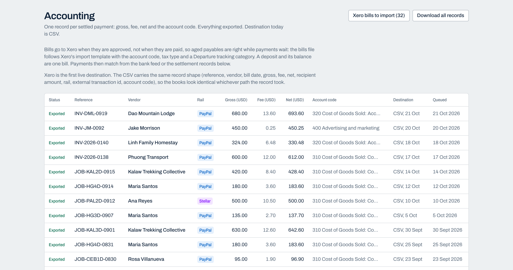

# Checkrail Pay for the accounting ecosystem: Xero pitch

One page. For a Xero partnerships or app ecosystem conversation.

## What Checkrail Pay is

Checks every supplier payment before money moves.

For small service businesses that pay dozens of freelance suppliers from chat messages, Checkrail Pay checks every request against the job it is for, pays the clean ones over PayPal inside limits you set, and stops the rest with a one-line reason. US bill-pay tools assume a purchase order. Checkrail works from job sheets, bookings and rate cards, and it never holds your money.

## The problem your customers have

A Xero customer with freelance suppliers abroad (a tour operator, an agency with freelancers in the Philippines, a logistics firm with local drivers) runs payables in three places: a chat thread where requests arrive, a PayPal or bank tab where money leaves, and Xero, where someone retypes what happened a week later. The bookkeeper spends hours matching payouts to bills, fees are posted as mystery differences, and duplicates and inflated invoices get through because nothing in the chain checks them.

## What Checkrail Pay writes into Xero

Today, bills go to Xero as a file in Xero's own "Import bills" template (Business, Bills to pay, Import), written at approval, so aged payables are right while payments are still waiting. One bill per invoice: a deposit and a balance against one invoice are one bill. The file carries the contact, invoice number, dates, account code, tax type, currency and a tracking option for the departure. Credit notes go in the same file as negative bills.

For every settled payment the mapping produces four records that reconcile to the cent:

- **Contact**: the vendor, with country on the address.
- **Bill (ACCPAY)**: reference, bill date, description, gross amount and currency, account code.
- **Payment**: payment date and net paid, against the bank account for the rail (PayPal clearing or Stellar treasury).
- **Bank fee line**: the rail fee on a bank fees account, so gross, fee and net tie out.

The mapping is covered by tests and the CSV exporter today. It is an import file, not a live push: OAuth to a live tenant is the remaining step.

## Why this is good for Xero

- It removes the hardest manual reconciliation in a small business's cross-border book: payouts to individuals by email or local bank account, with fees and FX.
- The check happens before the money moves. Other tools reconcile payouts too; this one stops the wrong ones first.
- The audit log behind every record (what was requested, what evidence was checked, which rule fired, who approved, which rail paid, with idempotency keys) is what an advisor wants when a client asks "why did we pay this".
- The customer is already on Xero. Checkrail Pay makes Xero the system of record for the whole payment, not just the aftermath.

## What we would ask Xero for

1. **App marketplace listing** in bills and payments, once OAuth is live.
2. **A practice channel introduction**: a handful of accounting firms in Xero's partner programme serving travel, agency and field-service clients with freelance suppliers abroad, for a pilot of five to ten client businesses.
3. **A developer contact** for payments-adjacent questions: bank account mapping for a stablecoin treasury, and multi-currency bill handling when the payout currency differs from the bill currency.

## What we offer in return

Clean, reconciled data; an honest, published corridor benchmark that advisors can cite; and a product whose purpose is to make Xero the place where every supplier payment is already done.

## Regional note

Xero is the right ledger for foreign-registered operators and their bookkeepers in the US, Australia and Singapore. In Vietnam the ledger market is MISA, so a MISA export is the regional next step, built the same way as the Xero bills file.

Contact: Daniel Fillion, founder. Repository: [paste the public GitHub URL once H3 is done].
