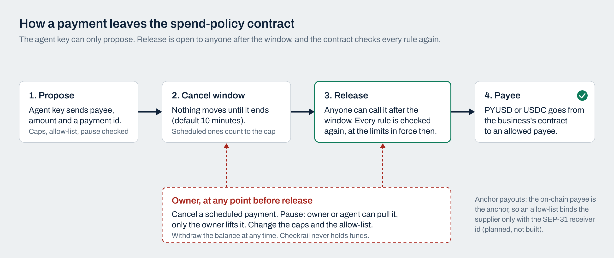

# Stellar Community Fund: Build Award application (draft)

Draft for a future round. Whether and when to apply is founder decision F3 in `docs/FOUNDER_DECISIONS.md`. Do not paste this line or anything above the interest form. Before a #47 submission this draft still needs the Integration-track rewrite described under F3 (OpenZeppelin smart accounts, pilots as traction).

## Interest form

**Project name.** Checkrail spend policy (first user: Checkrail Pay)

**One-line description.** A Soroban spending-policy account that an AI payables agent can use but cannot abuse: per-payment cap, rolling 24-hour cap, payee allow-list, a time-locked cancel window and an owner pause key.

**Summary (one paragraph).** AI agents are starting to pay suppliers. Today their limits live in the same server as their keys, so a compromised server or a confused model can overspend. The Checkrail spend policy moves those limits onto Stellar. The business funds a Soroban contract with its own PYUSD or USDC and stays its owner. The agent key can only propose a payment. Nothing moves until a cancel window has passed, and at release the contract checks every rule again: the per-payment cap, the rolling 24-hour cap (scheduled payments count), the payee allow-list that only the owner can change, and a pause that either side can pull but only the owner can lift. Checkrail Pay, an AI payables app for small service businesses, is its first user. Spending limits for agent accounts already exist on Stellar (OpenZeppelin's smart-account Spending Limit policy, and the REAPP mandate registry funded in SCF #43); this work adds the cancel window, the owner pause and release-time re-checks for supplier payouts, and builds on those where it can rather than replacing them.

**Category.** Payments (agent payments, B2B supplier payouts).

**Stage.** Contract written and unit-tested (20 tests); not yet deployed. The app it serves is a working MVP with a proven PayPal sandbox payout and a live Claude reader. Details below.

**Team.** Daniel Fillion, solo founder. Runs a tour operations business in Northern Vietnam that pays exactly this kind of supplier roster.

**Links.** Repository: [paste the public GitHub URL once H3 is done]. Demo video: on the project's PayPal AI Hackathon Devpost page.

## Full application

### Project summary

The Checkrail spend policy is a Soroban contract that holds a business's stablecoin float and lets an AI payables agent spend it only inside rules the chain enforces. The agent can propose. The chain decides whether the payment may ever leave, and the owner can stop it at any point before it does.

Checkrail Pay is the first user. It already enforces the same autopilot limits in its own database: a per-payment cap (default USD 500), a rolling 24-hour cap (default USD 2,000), a cancel window (default 10 minutes) and a pause. Those limits protect against a model mistake. They do not protect against a compromised server, because the server holds the key. Putting the limits in the contract closes that gap, and it gives Stellar a role in the product that PayPal and Wise cannot copy.

### Problem

Agent payments need limits the agent cannot edit.

Small service businesses pay dozens of freelance suppliers a month from chat messages and job sheets. AI can now read those requests and pay the clean ones. The safety model every serious team ships is the same: the AI proposes, deterministic rules decide, money moves through an API, a person can stop it. But on every rail today, the rules and the key sit on the same server. One leaked key or one bad deploy and the caps are gone.

### Solution: the spend-policy contract

The agent key can only propose; release is permissionless after the window and re-checks every rule.

| Rule | Who can change it | Enforced at |
|---|---|---|
| Per-payment cap | owner | propose and release |
| Rolling 24-hour cap, counting scheduled payments | owner | propose and release |
| Payee allow-list | owner only | propose and release |
| Cancel window before money moves | owner | release |
| Cancel a scheduled payment | owner | until release |
| Pause | owner or agent (the safe direction) | propose and release |
| Resume | owner only | |
| One payment per id (idempotency) | nobody | propose |
| Withdraw the balance | owner, any time | |

What this buys:
- A compromised Checkrail server can propose payments, but only to payees the owner allowed, only under the caps, and only after a window in which the owner can cancel or pause. It can also deny service: it can fill the contract's release list and freeze it for up to 24 hours (a finding still open in `docs/audits/`), so the pitch does not claim it can only ever be stopped instantly.
- For suppliers who hold their own Stellar wallet, a changed payout address needs the owner's signature on the allow-list, which closes the classic invoice-fraud path on chain.
- **Anchor corridors are different.** On an anchor payout (for example US to the Philippines through PeraHub over SEP-31) every supplier is paid by sending USDC to the anchor's receiving account, and the supplier is identified off chain in the SEP-31 transaction. The on-chain payee is the anchor for every supplier, so an allow-list of addresses alone protects nothing there. The fix is to bind each allowed payee to the anchor account plus the supplier's SEP-31 receiver id. That binding is planned, not built; until it exists, on-chain allow-listing applies only to wallet-holding payees.
- The business funds the contract and can withdraw at any time. Checkrail never holds funds.
- Lowered limits apply at release, so tightening a cap stops payments already scheduled.

### How Checkrail Pay uses it

Checkrail Pay reads each supplier request (Claude, or a rule-based reader), checks it against 25 deterministic policy rules, and pays the clean ones inside the owner's autonomy setting. Today its Stellar rail signs a PYUSD payment directly from a treasury key (written to the Stellar SDK, simulated, never run on testnet). With this grant, the Stellar rail proposes through the contract instead, the app's cancel and pause buttons call the contract, and a release watcher calls `release` after the window. The app's own policy still runs first; the contract is the second, independent wall.

### Why Stellar

1. **Programmability where it matters.** Soroban lets the limits live with the money. PayPal and Wise have no equivalent a payer can set and the payer's own software cannot override.
2. **Speed.** Stellar ledgers close in about 5 seconds. Our benchmark estimates 1 to 30 minutes end to end to a Philippine bank through an anchor, against 1 to 5 days for a standard PayPal withdrawal to a bank there.
3. **PYUSD on Stellar** (live since 18 Sep 2025, pitched for SMB working capital and supplier payments) is the natural float for a product that also pays over PayPal.
4. **Building blocks already exist.** OpenZeppelin's Stellar smart accounts ship a Spending Limit policy and an agent-wallet example. The fundable shape is to integrate those, with a small custom policy for the cancel window and the owner pause, rather than to ship a bespoke contract.

**Honest about cost.** Stellar is not the cheaper rail in our benchmark (`docs/CORRIDOR_BENCHMARK.md`). On published fees, PYUSD to a Philippine bank via PeraHub beats PayPal only above about USD 500, and Wise is cheaper than both at every size tested. PeraHub caps a transfer at 1,000 USDC with a 5 USDC fixed fee, and anchors take USDC, not PYUSD, so a path payment is needed. Vietnam has no licensed off-ramp, so there is no Stellar route for Vietnamese suppliers. Stellar wins on speed and programmability, and this application is built on those two, not on price.

### What is built

As of 29 Oct 2026:

- **Spend-policy contract:** written in Rust on soroban-sdk 29.0.1. 20 unit tests pass with `cargo test` (caps, rolling window, allow-list, cancel, pause and resume, idempotency, lowered limits at release, a failed transfer leaving the payment pending, owner-only and agent-only authorisation). Not deployed to testnet. Not called by the app yet.
- **Checkrail Pay app:** 604 tests in 68 files, named policy rules, a typed state machine with whitelisted transitions, idempotency on every rail attempt, autonomy levels with caps and a cancel window, a Daily close with audited sign-off, a Xero bills import file and CSV export.
- **PayPal Payouts sandbox: proven.** Batch RGS5PUZPH4CNY, USD 180 to Maria Santos, settled 12 Oct 2026. Batch W55KNGQK57JC4, USD 750 to Ana Reyes, came back UNCLAIMED and was held, not paid twice.
- **Claude (`claude-sonnet-5-5`): has read the full demo live,** with three read-only PayPal REST calls (Transaction Search and Invoicing).
- **Stellar PYUSD rail: simulated.** The adapter is written to the Stellar SDK with memo-based idempotency and has never run on testnet.
- **Reviews:** six review rounds on 16 Oct by AI agents briefed as critics, and three further review rounds from 25 to 27 Oct by AI agents briefed as a security analyst and as an AP practitioner, each working from a clean copy of the repo (`docs/audits/`). No human security audit has been done yet. Round 1 findings were fixed with tests; round 2 findings are listed with their status in `docs/audits/`, and some remain open.

### Tranches and ask

**Ask: USD 33,000**, inside the handbook's USD 25,000 to 50,000 band for one simple integration. The tranche split follows the SCF v7 structure (10% on award, 20% at MVP, 30% at testnet, 40% at mainnet with UX readiness); map it to whatever structure the round's handbook specifies.

| Tranche | Share | USD | Deliverable | Target |
|---|---|---|---|---|
| Award | 10% | 3,300 | Selection | On award |
| MVP | 20% | 6,600 | Contract and unit tests (done before award), plus: events indexed by the app, a TypeScript client for propose, cancel, pause and release, and a written threat model | 3 weeks from award |
| Testnet | 30% | 9,900 | Contract deployed to testnet. The app's Stellar rail proposes through it, the app's cancel and pause call it, and a release watcher releases after the window. A real testnet release with an explorer link, from the running app. PYUSD to USDC path payment on testnet. | 8 weeks from award |
| Mainnet | 40% | 13,200 | Security review through SCF's Audit Bank, fixes applied. Mainnet deployment. Three pilot businesses funding their own contract and paying real suppliers through it. Owner screens for limits, allow-list and pause. Published docs so another team can deploy it. | 6 months from award |

### Budget (itemised)

| Line | USD | Purpose |
|---|---|---|
| Contract engineering | 12,000 | Client library, events, threat model, edge cases (fee bumps, expired entries, token with clawback), anchor receiver-id binding for the allow-list |
| App integration | 14,000 | Stellar rail through the contract, cancel and pause wiring, release watcher, reconciliation of contract events |
| Testnet and mainnet operations | 4,000 | Deployment, monitoring, test float, explorer-linked evidence for each milestone |
| Docs and reuse | 3,000 | Public deployment guide and example for other agent-payments teams |
| **Total** | **33,000** | |

Not in this budget, because SCF does not fund them: the contract's security review (SCF's Audit Bank covers audits separately), legal fees and entity registration, and pilot onboarding (marketing and user acquisition).

### Success metrics

- Contract deployed on mainnet and called by the running app for every Stellar payment.
- Three businesses with funded spend-policy contracts, and the PYUSD or USDC held in them.
- Payments released through the contract, and payments the contract refused (caps, allow-list, pause), both from on-chain events.
- At least one outside team deploying the contract.
- No payment ever released outside the rules, verified from contract events.

### Context: the PYUSD rail

Checkrail Pay routes between PayPal Payouts, Stellar PYUSD, Wise and a Vietnamese bank file, with vendor preference first and then effective cost. The first Stellar corridor is US to the Philippines through PeraHub (SEP-31), which requires a sending-anchor agreement not yet in place. That corridor work is context for this grant, not its deliverable: this application funds the contract and its first real use.

### Risks and mitigations

- **No testnet transaction yet.** The build environment had no network path to Stellar. Mitigation: a real testnet release from the running app is a condition of applying (F3).
- **Anchors accept USDC, not PYUSD.** Mitigation: fund contracts in USDC where an anchor leg is needed, or path-pay PYUSD to USDC first. Liquidity is unproven: our benchmark found no PYUSD/USDC pool with reserves, so slippage will be measured on testnet first.
- **Solo founder.** Mitigation: hire a part-time Soroban engineer from the testnet tranche. The contract's security review goes through SCF's Audit Bank, not this budget.
- **No traction yet.** Mitigation: pilot letters are being sought from tour operators in Northern Vietnam. Until they arrive there is no traction to show, and this draft says so.
- **Regulatory posture.** The business owns the contract and its funds; Checkrail sends instructions and never holds money. A payments-law opinion is needed and is paid for outside this grant (SCF does not fund legal fees).
- **AI error.** The model has no spending authority in the app, and with this contract a compromised app cannot overspend either.

### Team

Daniel Fillion, solo founder. Runs a tour operations business in Northern Vietnam that pays guides, drivers and homestays from chat requests every week. Hands-on builder; the app was built with AI-assisted engineering under a two-lane model (an AI builder lane and a human gate on every money-path change, see CONTRIBUTING.md). Prior exposure to SCF-funded Stellar work through a separate team (Logistech Global) is relevant experience with the ecosystem and its process; that team is not part of this project.
